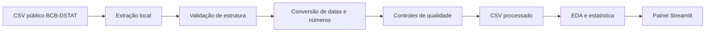

# Crédito às pessoas físicas: juros e inadimplência

## Identificação acadêmica

- **Curso/disciplina:** Visualização de Dados e BI.
- **Turma:** T1.
- **Professor:** Rodrigo Garcia Brunini.
- **Atividade:** Projeto Avaliativo do Módulo 2 — Semana 13.

Projeto desenvolvido como atividade avaliativa da disciplina, integrando tratamento de dados com Python, análise estatística, visualização e uma aplicação interativa de Business Intelligence em Streamlit.

Aplicação de Business Intelligence desenvolvida em Python e Streamlit para acompanhar a evolução dos juros e da inadimplência do crédito livre às pessoas físicas no Brasil. O projeto usa quatro séries mensais públicas do Banco Central do Brasil (BCB), cobre janeiro de 2012 a agosto de 2026 e oferece filtros, indicadores, estatísticas descritivas, análise de correlação e comparação de defasagens.

## 1. Problema, objetivo e importância

**Pergunta orientadora:** como os juros do crédito pessoal e do cartão e a inadimplência das pessoas físicas evoluíram no Brasil, e que associação temporal aparece entre o custo do crédito e os atrasos superiores a 90 dias?

O tema é relevante para profissionais de crédito, risco, planejamento financeiro, educação financeira e análise econômica. O objetivo é transformar séries extensas em uma leitura acessível, reproduzível e interativa. O painel não recomenda produtos financeiros nem estima risco individual.

## 2. Escopo e resultados esperados

O projeto analisa:

- juros anuais médios de novas operações de crédito pessoal e cartão;
- percentual inadimplente da carteira livre total das pessoas físicas e do cartão;
- níveis, variações, médias, extremos e tendências mensais e anuais;
- correlação de Pearson contemporânea;
- correlação exploratória entre juros no mês `t` e inadimplência até 12 meses depois.

Ficam fora do escopo: previsão, inferência causal, avaliação de consumidores, segmentação por renda ou região, crédito direcionado e recomendação de política pública. O trabalho é concluído quando o ETL é reproduzível, os controles de qualidade passam e a aplicação permite responder à pergunta com os recortes disponíveis.

## 3. Fonte, licença e método de obtenção

Os dados são públicos, agregados e publicados pelo **Banco Central do Brasil - Departamento de Estatísticas**, no Sistema Gerenciador de Séries Temporais (SGS). O catálogo informa licença **Open Data Commons Open Database License (ODbL)**. Acesso consultado em 21 de outubro de 2026.

| Código SGS | Série                                                        | Unidade | Catálogo oficial                                                                                                                                 |
| ----------- | ------------------------------------------------------------- | ------- | ------------------------------------------------------------------------------------------------------------------------------------------------- |
| 20748       | Juros - pessoas físicas - crédito pessoal total             | % a.a.  | [BCB](https://dadosabertos.bcb.gov.br/dataset/20748-taxa-media-de-juros-das-operacoes-de-credito-com-recursos-livres---pessoas-fisicas---credito-) |
| 21112       | Inadimplência - pessoas físicas - total                     | %       | [BCB](https://dadosabertos.bcb.gov.br/dataset/21112-inadimplencia-da-carteira-de-credito-com-recursos-livres---pessoas-fisicas---total)            |
| 21129       | Inadimplência - pessoas físicas - cartão de crédito total | %       | [BCB](https://dadosabertos.bcb.gov.br/dataset/21129-inadimplencia-da-carteira-de-credito-com-recursos-livres---pessoas-fisicas---cartao-de-credit) |
| 22024       | Juros - pessoas físicas - cartão de crédito total          | % a.a.  | [BCB](https://dadosabertos.bcb.gov.br/dataset/22024-taxa-media-de-juros-das-operacoes-de-credito-com-recursos-livres---pessoas-fisicas---cartao-d) |

O arquivo foi obtido por download público no BCB-DSTAT e fornecido em CSV. Esse método é aceito pelo escopo do projeto por ser um arquivo público de fonte oficial com a forma de obtenção documentada. O pipeline preserva uma cópia bruta, a impressão digital SHA-256 e a identificação das séries. Não há dados pessoais, sensíveis ou credenciais.

## 4. Pipeline e metodologia



O ETL executado em `src/data_pipeline.py`:

1. detecta a codificação e lê o CSV separado por ponto e vírgula;
2. reconhece as séries pelos códigos SGS, sem depender do texto completo do cabeçalho;
3. separa a linha final de fonte das observações mensais;
4. converte `mmm/aa` em data e a vírgula decimal em número;
5. valida campos obrigatórios, valores ausentes, datas duplicadas e lacunas mensais;
6. grava a base processada e um relatório de qualidade com o hash do arquivo original.

A EDA calcula estatísticas de posição e dispersão, extremos, variações em pontos percentuais, médias anuais e correlações. A análise de defasagem correlaciona juros em `t` com inadimplência em `t + k`, para `k` de 0 a 12 meses. Essa comparação é exploratória e não constitui um teste causal.

## 5. Bibliotecas e tecnologias

- [Python](https://www.python.org/) - linguagem do pipeline, testes e aplicação;
- [pandas](https://pandas.pydata.org/docs/) - leitura, transformação e análise tabular;
- [NumPy](https://numpy.org/doc/) - ajuste linear e operações numéricas;
- [Plotly](https://plotly.com/python/) - gráficos interativos;
- [Streamlit](https://docs.streamlit.io/) - interface, filtros, métricas e publicação;
- `unittest` - testes do pipeline e dos resultados de referência;
- Git e GitHub - versionamento e publicação do código.

As dependências de produção estão fixadas em `requirements.txt` para tornar o deploy reproduzível.

## 6. Resultados encontrados

Após o tratamento, a base contém **176 meses completos**, sem lacunas, ausências ou datas duplicadas.

- Em **agosto de 2026**, último mês disponível, os juros eram **52,59% a.a.** no crédito pessoal e **97,77% a.a.** no cartão. Em 12 meses, as variações foram +3,25 e +6,00 pontos percentuais, respectivamente.
- A inadimplência total das pessoas físicas chegou a **8,01%**, e a inadimplência do cartão a **9,96%** em agosto de 2026. Ambos são os maiores valores do recorte e aumentaram 1,04 e 1,00 ponto percentual em 12 meses.
- No período completo, a correlação contemporânea entre juros do crédito pessoal e inadimplência total foi **0,488**. Para cartão, juros e inadimplência apresentaram correlação **0,680**.
- Entre as defasagens testadas, a maior correlação absoluta ocorreu em **3 meses** para crédito pessoal versus inadimplência total (`r = 0,528`) e em **1 mês** para cartão (`r = 0,683`).
- Os menores níveis do recorte concentram-se entre 2020 e 2021. A inadimplência total atingiu 4,09% em março de 2021, e a do cartão, 3,79% em abril de 2021. Essa coincidência temporal exige contexto adicional e não deve ser lida isoladamente.

## 7. Discussão e conclusão

Os dados sustentam três conclusões descritivas. Primeiro, o custo e a inadimplência do crédito cresceram de forma relevante após os níveis baixos de 2020-2021. Segundo, o cartão manteve juros e inadimplência superiores aos indicadores comparáveis do crédito pessoal na maior parte do recorte. Terceiro, as associações positivas e as defasagens curtas justificam monitoramento conjunto, mas não provam que uma série cause a outra.

Juros representam novas concessões ponderadas pelo valor contratado; inadimplência representa o estoque com atraso superior a 90 dias. Além disso, inflação, renda, emprego, composição da carteira, renegociações, regulação e condições macroeconômicas não foram controlados. Uma interpretação causal exigiria variáveis adicionais e desenho estatístico apropriado.

## 8. Aplicação profissional

O pipeline pode apoiar uma área de risco, planejamento ou inteligência de mercado como painel de contexto macro de crédito. Para uso corporativo, recomenda-se:

- atualização automatizada pela API BCData/SGS e monitoramento de falhas;
- catálogo de dados, versionamento, validações e responsáveis definidos;
- acompanhamento de revisões metodológicas do BCB;
- testes de regressão para métricas e gráficos;
- controle de acesso caso sejam adicionados dados internos;
- separação explícita entre indicadores agregados e decisões sobre clientes.

## 9. Aplicação Streamlit

**Deploy:** [sctechprojetofinal-suellensantos.streamlit.app](https://sctechprojetofinal-suellensantos.streamlit.app/)

Funcionalidades:

- seleção de período;
- alternância entre crédito pessoal e cartão;
- métricas com variação em 12 meses;
- séries mensais e médias anuais;
- dispersão, tendência linear e correlação;
- análise interativa de defasagem de 0 a 12 meses;
- estatísticas descritivas, dicionário, metodologia e limitações;
- download do recorte filtrado.

### Como interpretar os gráficos e indicadores

- **Linhas mensais:** acompanham a evolução dos juros (% ao ano) e da inadimplência (% da carteira). As unidades são diferentes e aparecem nos respectivos eixos.
- **Médias anuais:** calculadas somente com os meses presentes no filtro. Todos os anos incompletos recebem um asterisco no eixo e um aviso com a quantidade de meses; o valor não é uma projeção anual. Compare períodos com cobertura semelhante.
- **Dispersão:** cada ponto representa um mês. A linha pontilhada resume a associação linear e não demonstra causalidade.
- **Defasagem:** compara juros no mês `t` com inadimplência em `t + k`. As barras indicam correlações exploratórias, e a quantidade de pares diminui à medida que a defasagem aumenta.
- **Variação em 12 meses:** diferença em pontos percentuais entre o último mês selecionado e o mesmo mês do ano anterior. Exige pelo menos 13 observações mensais no filtro; em recortes menores, a comparação fica indisponível. A variação no período compara o primeiro e o último mês selecionados.
- **Cores das variações:** aumentos de juros ou inadimplência aparecem em vermelho e reduções em verde. A cor apenas destaca a direção do indicador e não constitui recomendação financeira.

A fonte Banco Central do Brasil (BCB/DSTAT), SGS, acompanha cada gráfico, inclusive nas exportações de imagem pelo Plotly. Resultados, médias, correlações e estatísticas respeitam o período filtrado.

## 10. Como executar

Pré-requisitos: Git e Python 3.13 (64 bits). Execute os comandos dentro da pasta `Suellen_Santos`.

Crie o ambiente virtual no computador em que o projeto será executado. Não copie a pasta `.venv` entre instalações ou versões do Python; instale as dependências pelo `requirements.txt`. Para o deploy, selecione Python 3.13 para acompanhar a versão do ambiente local.

Depois de clonar o repositório da turma, entre na pasta do projeto:

```powershell
Set-Location "Projetos/Projeto_Final_do_Curso/Suellen_Santos"
```

No clone do repositório pessoal, entre em `Suellen_Santos`. Os comandos seguintes devem ser executados na pasta que contém `app.py` e `requirements.txt`.

```bash
python --version
python -m venv .venv
```

No Windows PowerShell:

```powershell
.venv\Scripts\Activate.ps1
python -m pip install -r requirements.txt
python -m pip check
python -m src.data_pipeline
python -m unittest discover -s tests -v
streamlit run app.py
```

No Linux ou macOS:

```bash
source .venv/bin/activate
python -m pip install -r requirements.txt
python -m pip check
python -m src.data_pipeline
python -m unittest discover -s tests -v
streamlit run app.py
```

A aplicação usa caminhos relativos à raiz e não exige variáveis de ambiente. Para refazer o ETL com outro arquivo compatível:

```bash
python -m src.data_pipeline --input caminho/arquivo.csv
```

## 11. Estrutura de pastas

```text
.
├── .streamlit/
│   └── config.toml
├── data/
│   ├── processed/
│   │   ├── credito_pf_mensal.csv
│   │   └── etl_report.json
│   └── raw/
│       └── bcb_series_credito_pf.csv
├── scripts/
│   └── build_data.py
├── src/
│   ├── analysis.py
│   ├── charts.py
│   └── data_pipeline.py
├── tests/
│   ├── __init__.py
│   └── test_pipeline.py
├── .env.example
├── .gitignore
├── app.py
├── requirements.txt
└── README.md
```

O CSV original fornecido pode permanecer na raiz para rastreabilidade; o ETL cria a cópia canônica em `data/raw/`.

## 12. Versionamento e publicação

O projeto mantém um repositório pessoal e uma cópia na pasta `Projetos/Projeto_Final_do_Curso/Suellen_Santos` do repositório da turma. O histórico desta pasta registra a inclusão do projeto e atualizações do README. As alterações devem ser registradas em commits com mensagens que descrevam o trabalho realizado, seguindo o fluxo de colaboração definido para cada repositório.

O `.gitignore` exclui ambientes virtuais, caches, arquivos temporários e configurações com segredos. A pasta `.venv` é local e não faz parte da entrega. Ao preparar commits no repositório da turma, selecione somente os arquivos deste projeto e confira o diff antes do envio.

Para configurar um deploy a partir do repositório da turma, o arquivo principal é `Projetos/Projeto_Final_do_Curso/Suellen_Santos/app.py`. No repositório pessoal, é `Suellen_Santos/app.py`. O endereço do deploy já informado neste documento foi preservado; confirme o repositório e a branch associados no painel do Streamlit antes de atualizar a aplicação.

## 13. Limitações e melhorias futuras

- o recorte termina em agosto de 2026 e o último ano está incompleto;
- as quatro séries são agregadas e não permitem segmentar consumidores;
- correlação bruta entre séries temporais pode ser elevada por tendências e autocorrelação;
- as definições de juros e inadimplência usam bases conceituais diferentes;
- a análise não controla variáveis macroeconômicas nem mudanças regulatórias;
- o CSV é uma fotografia e não recebe atualizações automáticas.

Melhorias: coleta via API do SGS, deflatores e variáveis macroeconômicas, testes de estacionariedade, modelos com defasagens distribuídas, detecção de quebras estruturais e alertas de atualização.

## 14. Créditos e referências

- [Banco Central do Brasil - Portal de Dados Abertos](https://dadosabertos.bcb.gov.br/)
- [Sistema Gerenciador de Séries Temporais - SGS](https://www3.bcb.gov.br/sgspub/)
- [Documentação do Streamlit](https://docs.streamlit.io/)
- [Documentação do pandas](https://pandas.pydata.org/docs/)
- [Documentação do Plotly para Python](https://plotly.com/python/)

Projeto acadêmico desenvolvido individualmente. Fontes, bibliotecas e decisões analíticas estão identificadas para permitir auditoria e reprodução.

## 15. Links de entrega

| Item                          | Link                                                                                                                                                                                                                                                                                              |
| ----------------------------- | ------------------------------------------------------------------------------------------------------------------------------------------------------------------------------------------------------------------------------------------------------------------------------------------------- |
| Repositório pessoal          | [github.com/suellencsantos/SCTech_Projeto_Final.git](https://github.com/suellencsantos/SCTech_Projeto_Final.git)                                                                                                                                                                                   |
| Aplicação publicada         | [sctechprojetofinal-suellensantos.streamlit.app](https://sctechprojetofinal-suellensantos.streamlit.app/)                                                                                                                                                                                          |
| Repositório oficial da turma | [github.com/Visualizacao-Dados-BI-T1/Projeto_ZP/tree/2aef8bd6e4fab658ea967dafb7fec7c39fbe617b/Projetos/Projeto_Final_do_Curso/Suellen_Santos](https://github.com/Visualizacao-Dados-BI-T1/Projeto_ZP/tree/2aef8bd6e4fab658ea967dafb7fec7c39fbe617b/Projetos/Projeto_Final_do_Curso/Suellen_Santos) |

O link da turma acima preserva a versão já informada. Para acompanhar as atualizações da branch principal, consulte também a [pasta do projeto em main](https://github.com/Visualizacao-Dados-BI-T1/Projeto_ZP/tree/main/Projetos/Projeto_Final_do_Curso/Suellen_Santos).

Itens complementares de entrega (endereços ainda não informados neste README):

| Item | Situação |
|---|---|
| Quadro de tarefas | Adicionar o endereço e conferir a permissão de acesso do avaliador. |
| Vídeo no Google Drive | Adicionar o link com acesso de leitor para qualquer pessoa com o endereço. |
| Publicação social | Adicionar o link do vídeo de até 3 minutos com as marcações do professor, LAB365, SENAI Santa Catarina e FIESC. |
| Submissão no AVA | Registrar os links exigidos e conferir a confirmação de envio. |

Esses itens seguem as exigências do PDF oficial do Projeto Avaliativo do Módulo 2. O preenchimento desta documentação não comprova a realização das etapas externas; confirme sua conclusão e eventuais orientações posteriores do professor no AVA.
